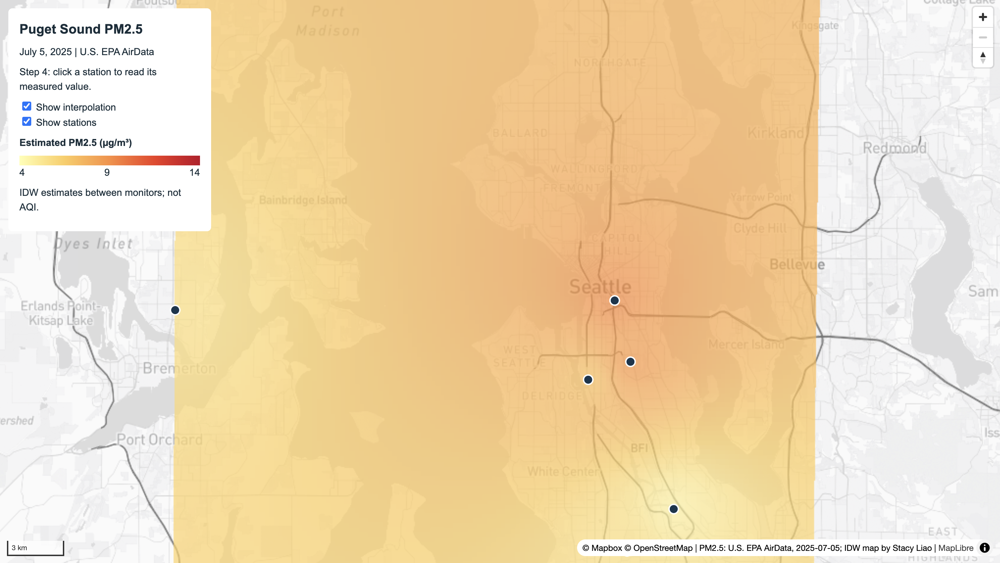
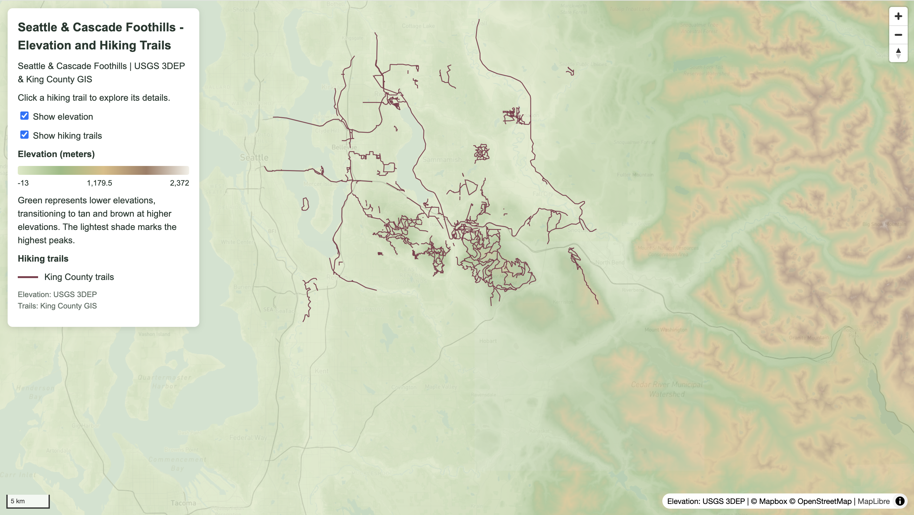

# GEOG 458 Lab 3: Map Design and Tile Generation

## 1. Project Overview

In this lab, I explored how to create interactive web maps by combining customized basemaps, raster tiles, and vector data. I used Mapbox Studio to design the basemaps, QGIS to process and visualize geographic data, QMetaTiles to export raster tile pyramids, and MapLibre GL JS to build interactive web maps.

I created two maps:

1. **Puget Sound PM2.5:** A guided map showing PM2.5 air pollution measurements and an interpolated pollution surface across the Puget Sound region.
2. **Seattle & Cascade Foothills – Elevation and Hiking Trails:** An independent map showing how elevation changes across the Seattle area and Cascade foothills, along with interactive hiking trails.

Both maps use locally generated raster tiles and GeoJSON vector data. Users can turn layers on and off, explore different locations, and click features to view additional information.

## 2. Map 1: Puget Sound PM2.5

### Purpose

The first map visualizes PM2.5 concentrations in the Puget Sound region on July 5, 2025. It combines air quality monitoring station measurements with an interpolated surface to illustrate how particulate pollution may vary across the region.

The purpose is to compare actual monitoring observations with estimated pollution values between monitoring stations.

### Data Sources

- **U.S. EPA AirData:** PM2.5 monitoring observations collected on July 5, 2025.
- **Mapbox Studio:** Customized Mapbox Light basemap.
- **Monitoring stations:** GeoJSON point data containing station locations and measured PM2.5 concentrations.

### Data Processing

I first cloned the Mapbox Light style in Mapbox Studio and customized its appearance. I adjusted road colors to make major highways darker than local roads and reduced unnecessary visual distractions so the air quality data would remain the focus.

Next, I published the customized basemap and connected it to QGIS through WMTS. Using QMetaTiles, I exported the basemap as PNG raster tiles for zoom levels 8–12.

For the air quality data, I imported PM2.5 observations from 11 monitoring stations into QGIS. I reprojected the station data to EPSG:32610 (WGS 84 / UTM Zone 10N) and used Inverse Distance Weighting (IDW) interpolation to estimate values between stations.

The IDW interpolation used a distance coefficient of 2 and a pixel size of 250 meters. I styled the output raster using a yellow-to-red color ramp, where lighter colors indicate lower estimated PM2.5 concentrations and darker orange-red colors indicate higher concentrations.

I then exported the interpolation surface as a separate PNG tile pyramid and combined both raster layers with station GeoJSON data in MapLibre GL JS.

### Interactive Features

- Toggle the PM2.5 interpolation surface on or off.
- Show or hide monitoring stations.
- Click a monitoring station to view its name, measured PM2.5 value, date, and station ID.
- Pan and zoom around the study area.
- Use the color legend to interpret estimated PM2.5 concentrations.

### Interpretation and Limitations

The monitoring station points represent measured PM2.5 concentrations, while the interpolation raster represents estimated values between those locations.

Because IDW interpolation is based on the distance between observations, the accuracy of the estimates depends on the number and geographic distribution of monitoring stations.

The map does not represent real-time air quality conditions, and interpolated PM2.5 values should not be treated as direct measurements or AQI values.

## 3. Map 2: Seattle & Cascade Foothills – Elevation and Hiking Trails

### Purpose

For my independent map, I wanted to explore how hiking trails are distributed across different elevations around Seattle and the Cascade foothills.

I chose this area because it contains both relatively flat urban areas and mountainous terrain, making it useful for comparing elevation changes. The map particularly highlights hiking trail networks around Cougar Mountain, Squak Mountain, Tiger Mountain, Issaquah, and surrounding areas.

By combining elevation data with hiking trails, users can better understand the geographic setting of trail networks and how terrain varies throughout the study area.

### Data Sources

- **USGS 3D Elevation Program (3DEP):** Digital Elevation Model (DEM) data downloaded from The National Map.
- **King County GIS:** Trails in King County vector dataset, including trail names, trail types, and surface types.
- **Mapbox Studio:** Customized light basemap designed to complement the elevation colors.

### Data Processing

I downloaded two USGS 1/3 arc-second DEM files covering Seattle and the Cascade foothills. I imported the GeoTIFF files into QGIS and merged them into a single elevation raster called `elevation_merged.tif`.

I styled the merged raster using Singleband Pseudocolor with linear interpolation and five elevation classes.

The elevation values and colors used were:

| Elevation (m) | Color | Description |
|---|---|---|
| -13 | `#DCE9C5` | Pale green |
| 583.25 | `#98BC81` | Green |
| 1,179.5 | `#DDBD82` | Tan |
| 1,775.75 | `#A17D64` | Brown |
| 2,372 | `#F3F0E8` | Pale cream |

Lower elevations appear in green, transitioning toward tan and brown at higher elevations. The highest elevations appear in a pale cream color.

For the basemap, I duplicated my original Mapbox Studio style and customized the land, water, and natural-area colors. I chose warm off-white land, soft blue water, and light green natural areas so they would not compete with the elevation raster.

I published the custom style and connected it to QGIS through WMTS.

Next, I exported both the basemap and elevation raster as separate PNG tile pyramids using QMetaTiles. The tiles use zoom levels 8–12 and 256 × 256 pixel images. The elevation layer was exported with transparency so the basemap could remain visible underneath.

For the hiking trails, I connected to the King County Trails ArcGIS REST service in QGIS. I selected trail features covering the study area and exported them as GeoJSON using EPSG:4326 (WGS 84).

Finally, I used MapLibre GL JS to display the local raster tiles and hiking trail vectors together in an interactive HTML map.

### Interactive Features

- Toggle the elevation raster on and off.
- Toggle hiking trails on and off.
- Click hiking trails to see their names, trail types, and surface types.
- Pan and zoom to explore different hiking areas.
- Compare trail locations with elevation patterns using the color legend.

### Map Design Choices

I used a green-to-brown elevation color ramp to make terrain differences easier to identify. The pale green lowlands contrast with the darker mountainous areas, while the lightest shade represents the highest elevations.

I set the elevation raster to partial transparency so roads, water bodies, and place labels from the basemap would remain visible.

Hiking trails are represented by burgundy lines to make them distinguishable from both the basemap and elevation colors. I also adjusted trail line widths across zoom levels to reduce clutter when users are zoomed out while keeping individual trails visible when zoomed in.

I chose an initial zoom level of approximately 9.5 to provide a regional overview of Seattle and the Cascade foothills. Users can zoom in further to explore specific trail networks.

### Interpretation and Limitations

The elevation raster represents a continuous model of terrain elevation based on USGS DEM data. However, the accuracy and detail of the terrain depend on the DEM's resolution.

The hiking trail layer contains mapped trail geometries and descriptive attributes from King County GIS. Some trails may be missing or outdated, particularly private trails or recently modified routes.

The two layers represent different types of geographic data. The elevation raster shows continuous terrain variation, while the vector layer represents individual trail segments that users can interact with.

The map is intended for geographic exploration and visualization rather than real-time navigation or assessment of hiking difficulty.

## 4. Raster Tiles and Vector Data

One of the main concepts I learned from this lab was the difference between raster tile pyramids and vector data in web mapping.

**Raster tiles** are pre-rendered images stored at different zoom levels. They are useful for displaying complex map styles and continuous geographic surfaces, such as air pollution or elevation, without requiring the browser to process the original GIS datasets.

However, raster tiles do not preserve the original feature attributes for direct interaction. For example, users can visually interpret elevation colors but cannot click the raster to retrieve exact elevation values in this implementation.

**Vector data**, such as GeoJSON, preserves individual geographic features and their attributes. This makes it possible to create interactive popups, apply feature-level styling, and display additional information.

In the PM2.5 map, the vector points represent monitoring stations with measured pollution values. In the hiking map, the vector lines represent trail segments with trail names and other attributes.

Combining raster and vector layers allows the maps to communicate overall spatial patterns while also providing more detailed information about individual geographic features.

## 5. Tools and Technologies

- **Mapbox Studio:** Creating and customizing basemap styles.
- **QGIS:** Importing, merging, reprojecting, and styling geospatial data.
- **QMetaTiles:** Exporting local PNG raster tile pyramids.
- **MapLibre GL JS:** Displaying interactive web maps.
- **GeoJSON:** Storing monitoring station and hiking trail vector data.
- **HTML, CSS, and JavaScript:** Building map layouts, legends, controls, and popups.
- **GitHub Pages:** Hosting the completed web maps.

## 6. Project Files

```text
lab3/
├── assets/
│   ├── elevation/
│   ├── mapbox-guided/
│   ├── mapbox-independent/
│   └── pm25-guided/
├── data/
│   ├── elevation_merged.tif
│   ├── hiking_trail.geojson
│   ├── pm25_idw.tif
│   ├── pm25_puget_sound_2025-07-05.csv
│   ├── pm25_source.json
│   └── pm25_stations.geojson
├── screenshots/
│   ├── hiking-map.png
│   └── pm25-map.png
├── stacyliao_lab3-1.html
├── stacyliao_lab3-2.html
└── README.md
```

The `assets` folder contains the four raster tile pyramids used in the maps. The `data` folder stores source and processed geospatial datasets, while the `screenshots` folder contains images of the completed maps.

Some large source raster files may be retained locally rather than committed to GitHub because of repository file-size limits.

## 7. Screenshots

### Map 1: Puget Sound PM2.5



This map displays the interpolated PM2.5 surface and individual air quality monitoring stations across the Puget Sound region.

### Map 2: Seattle & Cascade Foothills – Elevation and Hiking Trails



This map combines a color-coded elevation raster with hiking trails, allowing users to explore trail networks in relation to terrain.

## 8. Web Maps

Both interactive maps can be opened through the following links:

- **Guided Map:** [Puget Sound PM2.5](stacyliao_lab3-1.html)
- **Independent Map:** [Seattle & Cascade Foothills – Elevation and Hiking Trails](stacyliao_lab3-2.html)

## 9. References

- [U.S. EPA AirData](https://www.epa.gov/outdoor-air-quality-data)
- [USGS The National Map](https://apps.nationalmap.gov/downloader/)
- [USGS 3D Elevation Program](https://www.usgs.gov/3d-elevation-program)
- [King County GIS Data Catalog](https://www5.kingcounty.gov/sdc/)
- [Mapbox Studio](https://studio.mapbox.com/)
- [MapLibre GL JS Documentation](https://maplibre.org/maplibre-gl-js/docs/)
- [QGIS](https://qgis.org/)